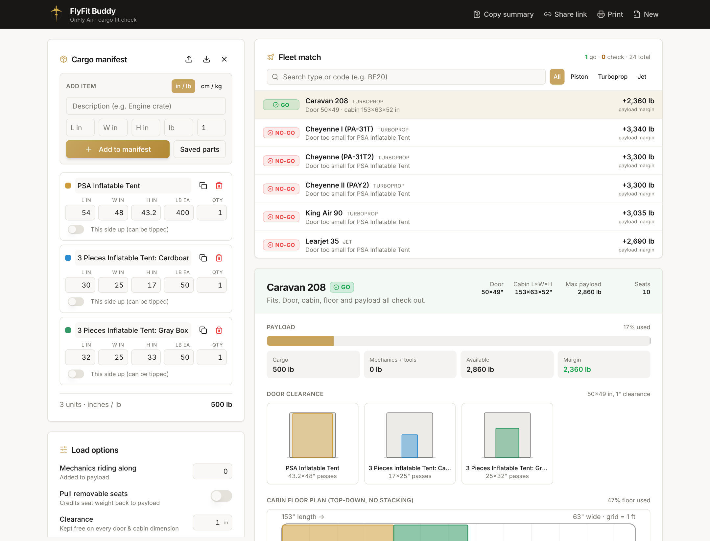

# FlyFit Buddy

**Air cargo fit calculator that checks whether cargo physically fits through aircraft doors and cabins — with real specs for 14+ aircraft types.**

Built for [OnFly Air](https://onflyair.com), our on-demand air charter brokerage, to streamline cargo planning for brokers who need fast answers on whether a shipment will work on a given aircraft.

<p align="center">
  
</p>

---

## What It Does

Enter the cargo once. Every aircraft in the fleet gets checked and ranked:

- **GO / CHECK / NO-GO per aircraft** — workable options first, smallest capable airframe first
- **Door clearance** — finds the best cross-section through the door (respects "this side up")
- **Cabin fit** — any orientation, with a configurable clearance margin
- **Floor plan** — top-down layout of every unit (quantities expanded), single layer, no stacking, working around the seats still installed
- **3D loading sequence** — fuselage with the door cut in, airstair down, seats in place; each unit comes up the ramp, lifts to the sill, enters at its computed angle, swings about its trailing end into the cabin, and slides to its spot. Units that can't pass are offered up and bump the opening.
- **Payload** — cargo + mechanics + tools, with optional seat-removal credit
- **Turn into the cabin** — plan-view geometry of the swing from a side door: the entry angle the door chord allows, the cabin width the swing needs, and how many seats in the swing zone have to come out (checked against the removable count)
- **Warnings** — floor overflow, payload above 90%

Built for daily use:

- Inline-editable manifest, quantities, duplicate, metric input (cm/kg converts to in/lb)
- CSV import/export (`Name, Length, Width, Height, Weight[, Qty, This side up]`)
- Autosaves locally; **Share link** reopens the exact load on any device
- **Copy summary** puts an email-ready write-up on the clipboard; **Print** gives a clean PDF

**Model limits:** cargo is a rectangular box, the cabin a rectangle. Fuselage taper, tie-downs, CG and fuel are not modeled. Door station, sill height and seat stations come from public layouts and are typical, not serial-specific. Irregular items (e.g. winglets) may fit where a box wouldn't. Confirm with the operator before quoting.

Fit logic lives in `src/lib/fit.ts` (pure, unit-tested). Aircraft specs live in `src/data/aircraft.ts`; per-type geometry (cargo door, station, side, sill, floor width, seat map, airframe shape) lives in `src/data/profiles.ts` with public sources per entry. Values marked approx are inferred from published overall dimensions, not quoted; verify against the W&B manual before relying on seat stations.

## Why I Built It

In charter brokerage, the first question is always "will it fit?" Brokers were manually looking up specs and doing mental math for every quote. This tool turns a 10-minute phone-call-and-spreadsheet process into a 30-second answer.

## Tech Stack

React · TypeScript · Vite · Tailwind CSS · shadcn/ui

## Run Locally

```sh
npm install
npm run dev      # http://localhost:8080
npm test         # fit engine tests
npm run build    # static site in dist/
```

---

*Built by [Paige Miller](https://github.com/paige-millz) for [OnFly Air](https://onflyair.com)*
